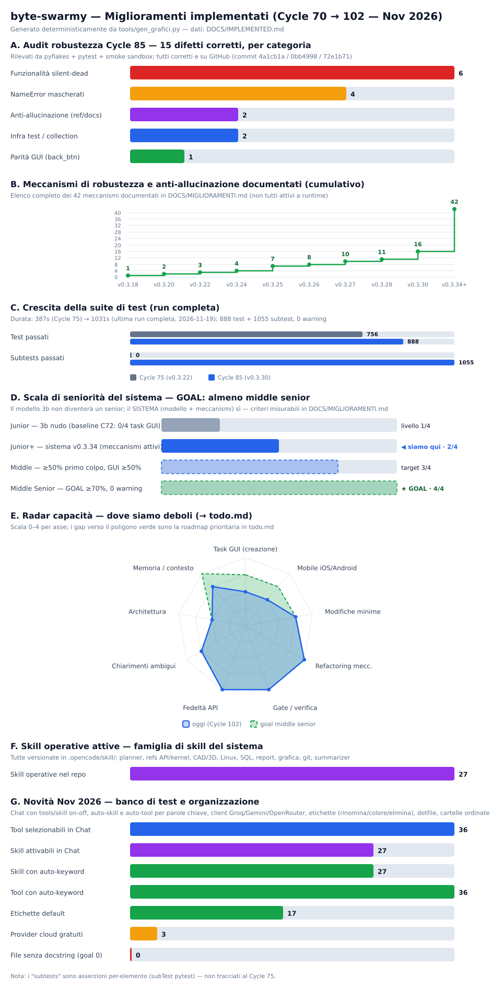

# 📈 Miglioramenti implementati — Cycle 70 → 86 (v0.3.18 → v0.3.34)

> Rigenera il grafico con: `.venv/bin/python tools/gen_grafici.py`
> (deterministico, zero LLM — stesso input → stesso SVG byte-per-byte)

---

## 🎯 Il Goal: sistema a livello Middle Senior

Il modello (qwen2.5-coder:3b) **non diventerà un senior** — il verdetto
del Cycle 72 è sperimentale e chiaro (4 run / 4 fallimenti su creazioni
PyQt6). Il goal dichiarato è che il **SISTEMA** (modello + gate +
executor deterministico + refs + clarifier + test) operi **almeno a
livello middle senior, o quanto più vicino possibile**.

Scala (grafico D, criteri misurabili):

| Livello | Criterio | Stato |
|---|---|---|
| **Junior** — 1/4 | 3b nudo senza sistema: 0/4 task GUI, modifiche minime fallite, requirements sovrascritto | baseline (C72) |
| **Junior+** — 2/4 | Sistema v0.3.34: 26 meccanismi attivi, gate per-slot + assembler + import-check, Zero Warning (0 pyflakes), corpus feedback, best-of-N, auto-skill/auto-tool, cartelle ordinate | **◀ siamo qui** |
| **Middle** — 3/4 | ≥50% dei task chiusi al primo tentativo (senza correction), task GUI ≥50% | target intermedio |
| **Middle Senior** — 4/4 | **≥70% al primo tentativo; task GUI ≥75%; 0 simboli API inesistenti nei file scritti (gate import-check); 0 violazioni gate; 0 warning (pyflakes + pytest — regola Zero Warning) ✅ raggiunto (474 → 0)** | ★ GOAL |

Come si misura: la stessa suite (`verify_cycle.sh` + test di parità +
benchmark di sessione). Ogni meccanismo della sezione B è un gradino
verso il goal; il progresso è un numero, non un'impressione.

### Radar per asse (grafico E) — dove siamo deboli

| Asse | Oggi | Goal | Gap → azione (todo.md) |
|---|:-:|:-:|---|
| Task GUI (creazione) | 1/4 | 3/4 | scaffolding deterministico (template) — SLOT-3 |
| Modifiche minime | 3/4 | 4/4 | best-of-N attivo (fast lane), executor + disciplina |
| Refactoring mecc. | 3/4 | 4/4 | estendere executor AST |
| Gate / verifica | 4/4 | 4/4 | punto di forza: gate per-slot + import-check |
| Fedeltà API | 3/4 | 4/4 | gate import-check (0 allucinazioni misurabili) + refs interni |
| Chiarimenti ambigui | 3/4 | 4/4 | clarifier esteso (3 pattern nuovi) |
| Architettura | 2/4 | 3/4 | SLOT: gate + assembler pronti, planner v2 (SLOT-3) |
| Memoria / contesto | 2/4 | 4/4 | import sistemato (C85): ora misurare l'impatto (P2-4) |

---

## A. Audit robustezza Cycle 85 — i 15 difetti corretti, per categoria

| Categoria | N. | Dettaglio |
|---|---:|---|
| **Funzionalità silent-dead** | 6 | persistent_memory mai importata (contesto nel prompt sempre vuoto), `run_test_suite` dead-on-arrival, path host nel sandbox (bandit/mypy/lint), combo modelli (`_ollama_installed` inesistente), `__main__` di center_area, `def embed` orfano |
| **NameError mascherati** | 4 | `proj_name` (tooltip barra), `subprocess` (fallback sensors), `log` nel fallback tomli, doppio import + riga morta (`temps`) |
| **Anti-allucinazione (ref/docs)** | 2 | cross-contamination ref Qt (pyside+QApplication → pyqt6.md), semantica errata `toolset_api.md` |
| **Infra test / collection** | 2 | `tests/archiviati` (file troncato tracciato rompeva l'exit code), TestToolbarToggle auto-start nei test |
| **Parità GUI (back_btn)** | 1 | DebtLedgerPanel e FanPanel senza via di ritorno alla Plancia |

Commit: `4a1cb1a` (12 difetti) · `0bb4998` (parità GUI) · `72e1b71` (toolbar).

---

## B. I 26 meccanismi di robustezza e anti-allucinazione attivi

| # | Meccanismo | Introdotto |
|--:|---|---|
| 1 | Regola di parità GUI (ogni funzione del ledger → controllo in Plancia) | v0.3.18 (C70) |
| 2 | Runner v2 + fix keyword skill (anti-hijack) | v0.3.20 (C72) |
| 3 | `verify_cycle.sh` — verifica end-to-end completa | v0.3.22 (C75) |
| 4 | Hard cap wall-clock `--max-run-sec` + ventole prerequisito | v0.3.24 (C77) |
| 5 | `PROTECTED_FILES` (requirements, config, .gitignore, ...) | v0.3.25 (C79) |
| 6 | Guardia anti-shrink sospetto (≥500 byte → <20% bloccato) | v0.3.25 (C79) |
| 7 | Suite gate toolset (14 test `test_toolset_gates.py`) | v0.3.25 (C79) |
| 8 | `GUI/refs/` cheat sheet + tool `list_refs()` | v0.3.26 (C81) |
| 9 | Iniezione condizionale refs nel prompt (soglia ≥2 keyword) | v0.3.26 (C82) |
| 10 | Ref WM espliciti (tkinter, pyside6) + matching word-boundary | v0.3.27 (C83) |
| 11 | Clarifier: GUI senza toolkit → domanda (ask-if-vague) | v0.3.28 (C84) |
| 12 | Mutua esclusione famiglie Qt nei ref | v0.3.30 (C85) |
| 13 | `conftest.py` root: collection ermetica (archiviati ignorati) | v0.3.30 (C85) |
| 14 | `_sandbox_argv`: traduzione path host→sandbox (bandit/mypy/test) | v0.3.30 (C85) |
| 15 | `run_test_suite` reale: test del progetto nel sandbox + fallback pytest | v0.3.30 (C85) |
| 16 | Test toolbar ermetici (mai subprocess dai test) | v0.3.30 (C85c) |
| 17 | Metrica "primo colpo %" (queue.db.first_try + report tool) | v0.3.31 (C85i) |
| 18 | Gate per-slot (pyflakes/AST sul frammento prima dell'assembly) | v0.3.31 (C85j) |
| 19 | Assembler deterministico (marker `# @@slot` / `# @@imports`) | v0.3.31 (C85j) |
| 20 | Gate import-check (0 allucinazioni API, retry ≤2) | v0.3.31 (C85j) |
| 21 | Corpus di feedback (Triple JSONL + hook worker + curate CLI) | v0.3.31 (C85k) |
| 22 | Best-of-N con gate come giudice (fast lane) | v0.3.32 (C85l) |
| 23 | Watchdog backoff escalato + guardia crash-loop | v0.3.32 (C85l) |
| 24 | Refs interni (orchestrator/ledger/scheduler) + validate_refs.py | v0.3.32 (C85l) |
| 25 | Clarifier esteso (test runner, handler sistema, formato config) | v0.3.32 (C85l) |
| 26 | Zero Warning: pyflakes 474 → 0 su CORE/GUI/tools/scripts/SAFETY/tests | v0.3.32 (C85m) |

---

## C. Crescita della suite di test (run completa)

| Metrica | Cycle 75 (v0.3.22) | Cycle 85 (v0.3.30) |
|---|---:|---:|
| Test passati | 756 | **789** |
| Subtests passati | non tracciati | **1050** |
| Fallimenti | 3 (pre-esistenti) | **0** |
| Durata run | 387 s | 1134 s |

La durata è cresciuta **perché i gate ora eseguono veri comandi sandbox**
invece di morire istantaneamente su NameError: più lento, ma finalmente
reale. Nessun flake residuo: `test_functional_swarm` passa da solo
(7 passed, 21 min — lento ma verde), `TestToolbarToggle` corretto.

---

## D. Versione per versione

| Versione | Cycle | Cosa è stato implementato |
|---|---|---|
| v0.3.18 | 70 | Ledger integrato nella GUI, regola di parità |
| v0.3.19 | 71 | Skill `project-radiography`, coda ledger per-progetto |
| v0.3.20 | 72 | Root-cause skill-hijack provata + fix keywords, runner v2 |
| v0.3.21 | 73 | Lezione UEFI, sweep MCP (57 conversioni bare except) |
| v0.3.22 | 75 | `verify_cycle.sh` end-to-end, skill `debt-ledger` |
| v0.3.24 | 77 | Ventole in Plancia, `--max-run-sec`, gate termica coretemp |
| v0.3.25 | 79 | `PROTECTED_FILES`, shrink guard, test gate |
| v0.3.26 | 81 | `GUI/refs/` + `list_refs()` |
| v0.3.26+ | 82 | Iniezione condizionale cheat sheet nel prompt |
| v0.3.27 | 83 | Ref WM espliciti (tkinter, pyside6) |
| v0.3.28 | 84 | Clarifier ask-if-vague per GUI |
| v0.3.30 | 85 | Audit robustezza: 15 difetti corretti, test ermetici |
| v0.3.33 | 86 | Chat = banco di test (tools/skill on-off), client cloud Groq/Gemini/OpenRouter, sorting Archivio, dettaglio task a 2 colonne, scan segreti |
| v0.3.34 | 86 | Auto-skill + **auto-tool** per parole chiave; fix 403 Groq (User-Agent Cloudflare); test cloud live (11 modelli, 0,78 s) |
| v0.3.34 | 86 | Dotfile `.editorconfig`, `.gitattributes`, `.env.example` (variabili cloud documentate, `.env` gitignored) |
| v0.3.34 | 86 | Riordino `TOOLS/REVERSE_ENGINEERING/` (refuso corretto, 14 riferimenti), regola cartelle in `AGENT.md` #11 + README, 0 file senza docstring in `CORE/GUI/tools` |

---

## E. Novità Cycle 86 — banco di prova modelli e organizzazione GUI (Nov 2026)

### Banco di prova modelli (Chat)

| Componente | File | Cosa fa |
|---|---|---|
| Pannello Chat | `GUI/chat_panel.py` | sezione collassabile in Plancia; source combo, models combo, tool/skill pickers, chiave API |
| Contesto selezionabile | `CORE/chat_context.py` | elenca tool (`TOOL_SIGNATURES`) e skill (`.opencode/skill/*/SKILL.md`), salva la selezione in `state/chat_tools_skills.json`, costruisce il blocco di system prompt (max 12k char) |
| Auto-skill | `CORE/auto_skill.py` | 23 skill con keyword IT/EN, matching su parole intere, max 4 skill per prompt; anteprima live mentre si scrive; keyword extra da `state/auto_skill_keywords.json` |
| Auto-tool | `CORE/auto_tool.py` | 30 tool di `TOOL_SIGNATURES` con keyword IT/EN, stesso motore di matching, max 4 tool per prompt; anteprima separata 🛠️; keyword extra da `state/auto_tool_keywords.json` |
| Client cloud | `CORE/cloud_client.py` | provider OpenAI-compatibili (Groq, Gemini, OpenRouter), `list_models`, `pick_default_model`, `chat`, chiavi in `state/cloud_api.json` (0600); User-Agent esplicito per aggirare il blocco Cloudflare 1010 |
| CLI di test | `tools/test_cloud_api.py` | `--save-key`, `--list`, `--prompt`, misura latenza e stampa la risposta |

Le skill restano **solo** in `.opencode/skill/`; le chiavi API non entrano mai
in git (`state/` → `data/`, entrambe gitignored) e il dialog usa
`EchoMode.Password`.

### Organizzazione GUI

| Miglioramento | Effetto |
|---|---|
| Toggle "Seleziona/deseleziona tutti" | glifo e stato coerenti (☐ vuoto / ☑ pieno) |
| Archivio — click su **Name** | ordine alfabetico A→Z, secondo click Z→A |
| Archivio — click su **📄** | raggruppa per estensione; secondo click inverte cartelle/file |
| Dettaglio task | due colonne: metadati/log a sinistra, **Risultato** e **Progetti** a destra |
| Codice prodotto | click sul file → codice effettivo nel viewer (con ▶ Esegui) |
| Etichette | pallini colore nel menu contestuale, settings, completer `#`, colori rapidi |
| Rinomina etichetta | pulsante ✏️ accanto a 🎨 Cambia colore e 🗑️ Elimina; `GUI/label_actions.py` aggiorna registro e task in un unico posto |
| Dotfile di configurazione | `.editorconfig` (stile = `tools/lint_style.py`), `.gitattributes` (LF + binari + `linguist-generated`), `.env.example` (variabili cloud debug/sandbox; `.env` gitignored) |
| Regola delle cartelle | contenitori di primo livello in MAIUSCOLO, una cartella per categoria, nessun refuso o duplicato — `AGENT.md` guardrail #11 e README |
| Riordino tool RE | `REVERSE_ENGEREENING_TOOLS/` → `TOOLS/REVERSE_ENGINEERING/`; 14 riferimenti aggiornati, `$ROOT` nella copia di setup corretto |
| Docstring di modulo | 0 file senza docstring in `CORE/GUI/tools` (completati i 3 `__init__.py` vuoti) |

### Sicurezza dei segreti

| Controllo | Dettaglio |
|---|---|
| `tools/security_scan.py` S030 | rileva token/credenziali nell'URL dei remote git (`.git/config`) |
| `tools/security_scan.py` S031 | rileva token reali (GitHub/Groq/Gemini/OpenRouter/AWS/Slack) nei file **tracciati** e nel diff staged |
| mascheramento | il finding mostra solo i primi 4 caratteri (`ghp_…(40 char)`), mai il token intero |
| remote git | URL pulito `https://github.com/wildlux/byte-swarmy.git`; credenziali nel credential helper dell'utente (`~/.git-credentials`, 0600, fuori dal repo) |

---

*Documento e grafico generati dal Cycle 86, allineati al codice il 2026-11-22 —
aggiornare `tools/gen_grafici.py` e rigenerare quando si aggiungono nuovi
meccanismi.*

---

## ✅ Stato finale verificato — Cycle 85n (2026-11-19)

- **Suite pytest completa**: `888 passed, 1 xfailed, 1055 subtests passed, 0
  failed, 0 warning, EXIT=0` (1031 s) — run finale **pulita** (nessun segfault,
  nessun fallito, nessun warning).
- **pyflakes**: 0 warning su CORE/GUI/tools/scripts/SAFETY/INTENT/tests
  (baseline 474 → 0).
- **Regola Zero Warning**: raggiunta (errori + warning = 0).
- **Grafico miglioramenti**: rigenerato deterministico (`tools/gen_grafici.py`).

Prossimi gradini verso Middle Senior (todo.md): Fase D-16, SLOT-3/4/5, P2-4,
Fase C/E/G/H, P3-8 — tutti richiedono run LLM (ventole al max, ≤60 °C) o GPU
notturna.
