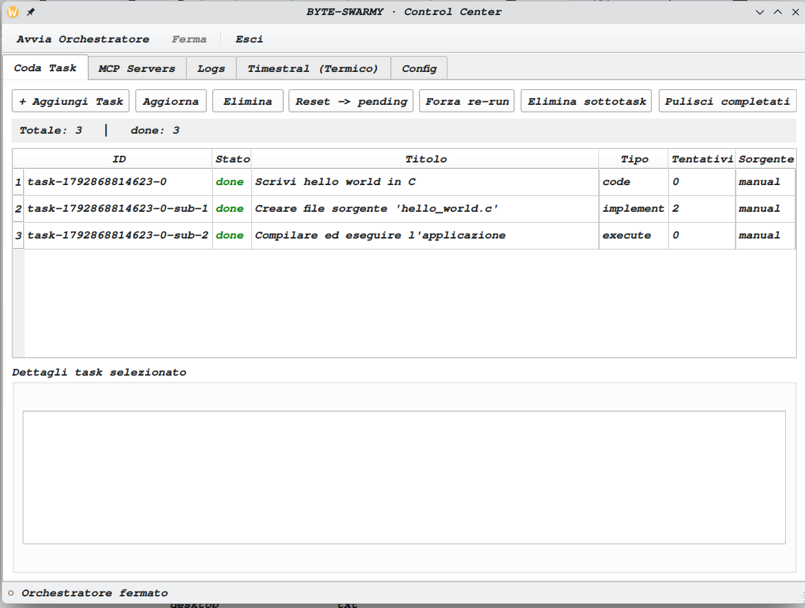
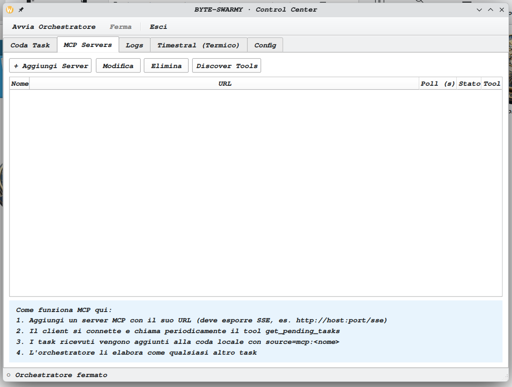
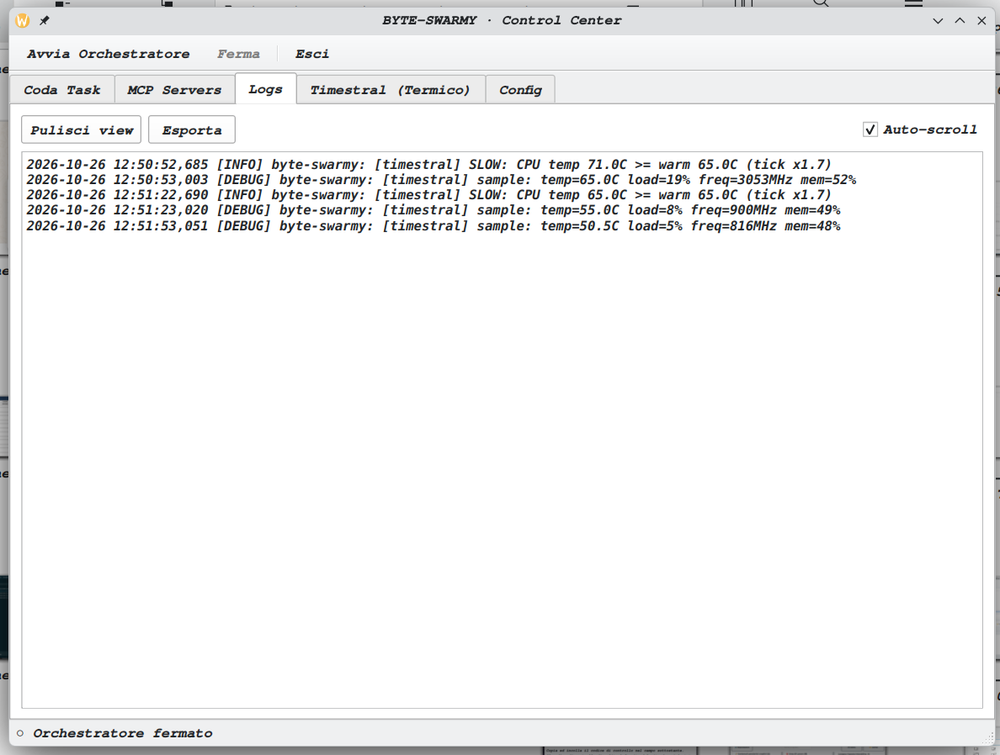
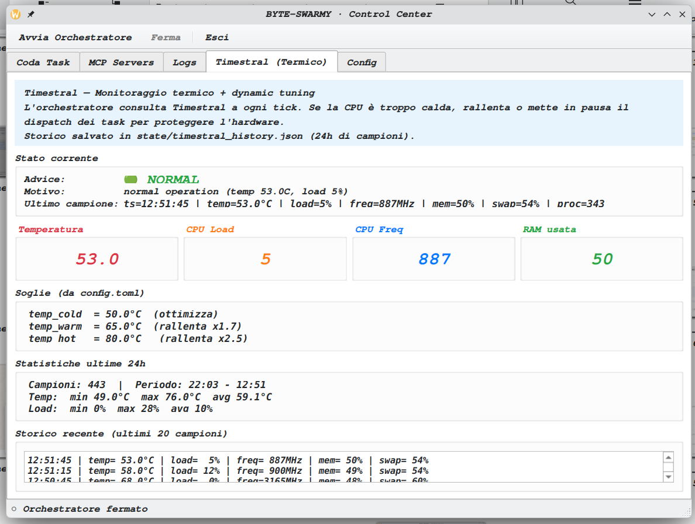
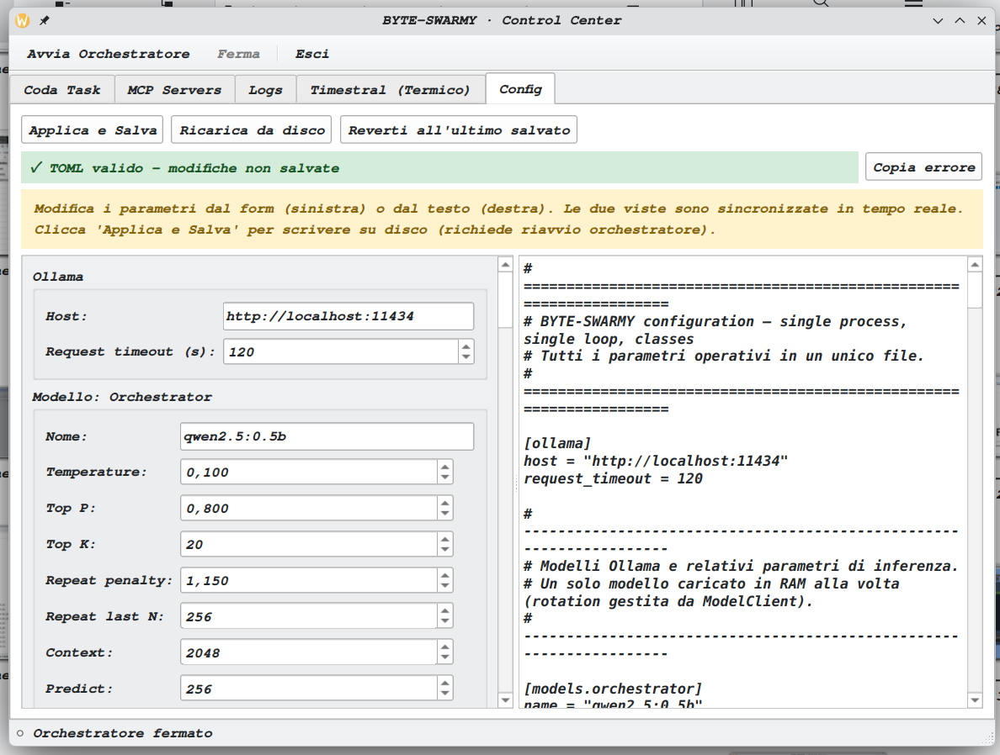

# BYTE-SWARMY

<p align="center">
  
</p>

<p align="center">
  <strong>Sistema multi-agente autonomo, interamente locale, per macchine con 4 GB di RAM.</strong>
</p>

<p align="center">
  <a href="https://github.com/wildlux/byte-swarmy/actions"></a>
  
  
  
  
  
  
  
</p>

<p align="center">
  <em>"The swarm works. You think elsewhere."</em>
</p>

---

> **Nessun cloud, nessuna GPU, nessuna dipendenza da servizi esterni:**
> solo Ollama, Python e file JSON. I worker eseguono task di programmazione,
> test e documentazione sotto il controllo di un orchestratore deterministico.

**Versione:** 0.1.0 · **Licenza:** MIT · **Piattaforma:** Linux

---

## Indice

- [Sicurezza](#sicurezza)
- [Panoramica](#panoramica)
- [Perché BYTE-SWARMY?](#perché-byte-swarmy)
- [Demo](#demo)
- [Architettura](#architettura)
- [Requisiti](#requisiti)
- [Installazione](#installazione)
- [Avvio rapido](#avvio-rapido)
- [Utilizzo](#utilizzo)
- [Come funziona](#come-funziona)
- [Sicurezza in profondità](#sicurezza-in-profondità)
- [Struttura del progetto](#struttura-del-progetto)
- [Sviluppo e test](#sviluppo-e-test)
- [Limiti noti](#limiti-noti)
- [Troubleshooting](#troubleshooting)
- [Compatibilità](#compatibilità)
- [Contribuire](#contribuire)
- [Licenza](#licenza)
- [Ringraziamenti](#ringraziamenti)

---

## Sicurezza

> **Regola 0 — la difesa è sempre attiva.**
> Ogni task è trattato come potenzialmente ostile (prompt injection). La policy
> di sicurezza è applicata nel codice a ogni chiamata di tool e **non può essere
> disattivata** da configurazione, prompt, task MCP o output del modello.

BYTE-SWARMY esegue codice generato da LLM piccoli con i permessi dell'utente che
avvia l'orchestratore. Le protezioni incluse bloccano i comandi più pericolosi,
ma **non sostituiscono un isolamento di sistema**:

- `run_bash` non usa una shell: allowlist, blacklist e path confinati in `project/`;
- `git push` / `pull` / `remote add|remove` sono disabilitati per i worker;
- ambiente sanificato (niente token, `SSH_AUTH_SOCK`, `HOME` reale);
- limiti di CPU, memoria, dimensione file e timeout sul process group;
- task MCP ricostruiti da zero e URL limitati a `http`/`https`;
- audit log con rotazione in `logs/security.log`.

`[security] enabled = false` in `config.toml` viene **ignorato** e registrato
come `CRITICAL`: il flag esiste solo per retrocompatibilità.

Per dati reali è necessario aggiungere l'isolamento di sistema (utente dedicato,
cgroup, firewall):

```bash
./setup-hardening.sh                  # diagnostica, nessuna modifica
sudo ./setup-hardening.sh --all       # utente byteswarmy + cgroup + firewall
```

Dettagli, modello di minaccia, rischi residui e rollback:
**[SECURITY.md](SECURITY.md)**.

Verifica della policy:

```bash
python -m unittest discover -s tests -t . -v
tail -f logs/security.log
```

---

## Panoramica

BYTE-SWARMY è un sistema multi-agente che gira interamente in locale su hardware
modesto (4 GB di RAM, solo CPU). Riceve un task, lo classifica, lo scompone se
necessario e lo esegue con worker specializzati. Lo stato è persistito su disco,
quindi il lavoro può riprendere dopo un riavvio.

### Enterprise Grade Quality Assurance

Il sistema implementa una pipeline di qualità professionale per garantire che il codice prodotto sia sicuro, testato e manutenibile:

| Feature | Descrizione | Vantaggio |
|---|---|---|
| **Audit Worker** | Un secondo agente (Reviewer) che controlla ogni modifica prima dell'approvazione. | Blocca bug e vulnerabilità prima che entrino nel progetto. |
| **TDD Obbligatorio** | L'agente deve scrivere e far fallire un test prima di implementare la soluzione. | Garantisce che il codice risolva esattamente il requisito richiesto. |
| **Refactor-Loop** | Protocollo di lavoro: Mappatura $\rightarrow$ Analisi $\rightarrow$ Intervento $\rightarrow$ Validazione. | Riduce le regressioni e mantiene il codice modulare. |
| **JSONL Logging** | Log strutturati e immutabili per ogni azione del sistema. | Audit completo e tracciabilità enterprise delle decisioni dell'AI. |
| **Prompt Governance** | Versionamento e metadati per ogni prompt utilizzato. | Riproducibilità e debug accurato del comportamento dell'agente. |

### Principi di progettazione


| Principio | Implementazione |
|---|---|
| **Routing deterministico prima dell'LLM** | Se una keyword identifica il worker, il planner viene bypassato: meno token e latenza minima. |
| **Stato = file JSON** | Coda, memorie e heartbeat sono ispezionabili con `cat` e ripristinabili manualmente. |
| **Scritture transazionali** | `write_file` scrive un file temporaneo nella stessa directory e poi esegue `rename()` atomico. |
| **Memoria compattata** | Dopo 50 eventi il contesto viene riassunto in `long_term`, evitando prompt fuori controllo. |
| **Loop sequenziale** | Nessun thread e nessun asyncio: un tick ogni 30 secondi, prevedibile e facile da monitorare. |
| **Safety valve** | Pausa automatica per RAM, disco, temperatura o CPU oltre soglia; shutdown pulito su SIGTERM. |

### Identità del nome

| Lettura | Significato |
|---|---|
| **Byte** | Unità di memoria: il codice prodotto è fatto di byte. |
| **Bite** | Morso: le api "mordono" i task e li scompongono. |
| **Bee** | Ape: lo sciame di agenti. |

**Acronimo:** **B**yte-**S**warm **W**ith **A**utonomous **R**esource
**M**anagement & **Y**ield.

---

## Perché BYTE-SWARMY?

| Senza BYTE-SWARMY | Con BYTE-SWARMY |
|---|---|
| Compri una GPU da €2000 | Usa il tuo laptop del 2015 |
| Dipendi da API cloud a consumo | Tutto in locale, gratis per sempre |
| 8 GB di RAM come minimo | 4 GB di RAM bastano |
| Codice nel cloud di terze parti | Codice tuo, sempre, ovunque |
| Coda task persa se chiudi il terminale | Stato persistito in JSON |
| L'LLM decide cosa eseguire | Orchestratore deterministico |
| Fidi del prompt di sistema | Policy di sicurezza nel codice |

---

## Demo

<p align="center">
  
</p>

<p align="center">
  <em>Control Center: coda task, worker in esecuzione e codice prodotto in <code>project/</code>.</em>
</p>

<details>
<summary><strong>Altre schermate</strong> (MCP, Logs, Timestral, Config)</summary>

<br>

| MCP Servers | Logs |
|---|---|
|  |  |

| Timestral | Config |
|---|---|
|  |  |

</details>

Cosa puoi vedere:

- il worker `worker_coder` che esegue un task di compilazione in `project/`;
- Timestral che mostra temperatura e carico CPU in tempo reale;
- l'audit log che registra ogni comando eseguito o bloccato dalla policy;
- la coda con task pending, in esecuzione e completati.

---

## Architettura

| Componente | Ruolo | Stack |
|---|---|---|
| **Orchestratore** | Loop principale, dispatch, safety check, compaction | Python |
| **Planner** | Scompone i task complessi quando il routing deterministico non basta | Ollama |
| **Worker** | Esegue il task atomico: file, shell controllata, git locale | Ollama |
| **Decision Models** | Classificazione e scomposizione dei task generici | Ollama |
| **Generic Task Planner** | Trasforma un task vago in task atomici | Ollama |
| **Timestral** | Monitor termico e tuning dinamico dei parametri | Python |
| **MCP Client** | Riceve task da server MCP esterni via SSE | Python |
| **GUI PyQt6** | Control Center con 5 tab | PyQt6 |
| **CLI Launcher** | `byte-swarmy` e alias `bswarm` | Bash |
| **Backup** | Snapshot git periodici e sync GitHub on-demand | git |

### Ciclo di un tick

```
┌──────────────────────────────────────────────────────────────┐
│  ogni 30 secondi (modulato da Timestral)                     │
│                                                              │
│  1. SAFETY CHECK   → RAM > 80%? Disco < 1 GB? → pausa        │
│  2. TIMESTRAL      → temperatura/CPU critiche? → pausa       │
│  3. MAINTENANCE    → backup git, memory compaction           │
│  4. DISPATCH       → leggi coda → routing → worker/planner   │
│  5. EXECUTE        → worker.run(task) → risultato            │
│  6. PERSIST        → memoria, eventi, stato su disco         │
│  7. SLEEP          → prossimo tick                           │
│                                                              │
└──────────────────────────────────────────────────────────────┘
```

---

## Requisiti

- Linux (testato su Kubuntu/Ubuntu; qualsiasi distro con Python 3.11+)
- Python 3.11+ (per `tomllib` nella standard library)
- Ollama installato e funzionante
- 4 GB di RAM minimo (8 GB consigliati)
- PyQt6 (opzionale, solo per la GUI)
- git (backup e sincronizzazione)

### Modelli Ollama

```bash
# Orchestratore (circa 700 MB)
ollama pull qwen2.5:0.5b

# Planner (circa 2.2 GB)
ollama pull phi3:mini

# Worker coding (circa 1 GB)
ollama pull qwen2.5-coder:1.5b

# Worker general (circa 1 GB)
ollama pull qwen2.5:1.5b

# Embedding (circa 274 MB)
ollama pull nomic-embed-text

# Decision model attivo (circa 2.5 GB) — opzionale ma consigliato
ollama pull tev1:4b
```

Altri decision model opzionali sono elencati nella sezione `[decision_models]`
di `config.toml`: `d3:2b`, `nimble:9b`, `clef-flash:9b`, `nimble-v3:9b`,
`pplx-decider:27b`, `kev`, `laya`, `strands-decider:2b`.

> Con 4 GB di RAM tieni attivo un solo modello grande alla volta. Il client
> gestisce caricamento e scaricamento espliciti con `keep_alive=0`.

---

## Installazione

```bash
git clone https://github.com/wildlux/byte-swarmy.git
cd byte-swarmy
./setup.sh
```

`setup.sh` verifica e, con conferma esplicita, installa:

- Python, pip, git e Ollama;
- pacchetti di sistema (`python3-venv`, `python3-full`, `git`) tramite `sudo`;
- virtualenv `.venv/` con pip funzionante;
- dipendenze Python: `PyQt6`, `tomli-w`, `mcp`, `httpx`, `httpx-sse`,
  `uvicorn`, `starlette`;
- modelli Ollama necessari (chiede prima di scaricarli);
- directory di lavoro: `state/`, `logs/`, `tasks/`, `project/`, `backups/`.

Per installare solo le dipendenze della GUI:

```bash
./.venv/bin/pip install -r requirements_gui.txt
```

---

## Avvio rapido

### Avvio completo

```bash
./avvia.sh
```

Lo script attiva il virtualenv, avvia l'orchestratore in background e apre la
GUI. Chiudendo la GUI l'orchestratore continua a girare.

Modalità alternative:

```bash
./avvia.sh --gui      # Solo GUI
./avvia.sh --orch     # Solo orchestratore in background
./avvia.sh --status   # Mostra lo stato ed esce
./avvia.sh --setup    # Forza setup.sh (check + install)
```

### Stato e arresto

```bash
./byte-swarmy status
./ferma.sh
```

`ferma.sh` invia SIGTERM, attende lo shutdown pulito e usa SIGKILL solo come
fallback. Prima di inviare segnali valida il PID file e verifica che il processo
sia realmente `orchestrator.py`.

### Primo task di verifica

```bash
./byte-swarmy queue add "Hello world in C" \
  "Crea project/hello.c con un programma che stampa 'Hello from BYTE-SWARMY!' e va a capo. Compila con gcc project/hello.c -o project/hello e verifica l'output. Massimo 30 righe."

./avvia.sh
```

Se `project/hello.c` contiene il sorgente e `logs/byte-swarmy.log` mostra i tick
di esecuzione, il loop funziona.

---

## Utilizzo

### CLI

```bash
# Avvio e arresto
byte-swarmy start              # Orchestratore in background
byte-swarmy stop               # Arresto con SIGTERM
byte-swarmy gui                # Avvia la GUI
byte-swarmy status             # PID, coda, ultimo campione termico

# Coda task
byte-swarmy queue list
byte-swarmy queue add <title> [desc]
byte-swarmy queue add-generic <title> [desc]   # Scomposto dal decision model
byte-swarmy queue reset <id>                   # Riporta il task a pending
byte-swarmy queue cleanup                      # Elimina i task completati

# Timestral
byte-swarmy thermal            # Ultimo campione
byte-swarmy thermal history    # Storico recente

# Codice prodotto
byte-swarmy honey              # Elenca project/
byte-swarmy honey log          # git log di project/

# Log e configurazione
byte-swarmy logs               # Tail del log (Ctrl+C per uscire)
byte-swarmy config edit        # Apre config.toml in $EDITOR

# MCP
byte-swarmy mcp start          # Avvia il server MCP di esempio
byte-swarmy mcp list           # Elenca i server MCP configurati

# Varie
byte-swarmy version
byte-swarmy help
```

Alias disponibile: `bswarm`.

### GUI Control Center

```bash
python gui.py
# oppure
./avvia.sh --gui
```

Cinque tab:

1. **Coda Task** — task pending, in esecuzione e completati. Azioni: aggiungi,
   aggiorna, elimina, reset, riesegui, elimina sotto-task, pulisci i completati.
2. **MCP Servers** — configura server MCP esterni, polling automatico e
   discovery dei tool.
3. **Logs** — tail in tempo reale, auto-scroll ed export.
4. **Timestral** — metriche live (temperatura, carico, frequenza, memoria),
   consigli operativi e storico.
5. **Config** — editor bidirezionale form↔TOML con validazione live, copia
   errore e revert automatico in caso di parametri non validi.

### Task generici

```bash
byte-swarmy queue add-generic "Sistema di note CLI" \
  "Voglio un sistema per prendere appunti da terminale. Comandi: add <text>, list, search <text>, delete <id>. Storage su file JSON. Massimo 250 righe totali."
```

Il decision model analizza la descrizione e genera da 2 a 8 task atomici, che
vengono accodati automaticamente.

### MCP Client

BYTE-SWARMY può ricevere task da server compatibili MCP. Il client è in
`mcp_client.py` ed è configurabile dal tab **MCP Servers**.

Server di esempio:

```bash
./byte-swarmy mcp start
```

Espone `http://127.0.0.1:8080/sse` con i tool `get_pending_tasks`, `add_task` e
`clear_outbox`. I task ricevuti vengono accodati con `source=mcp:<server>`.

> Il server di esempio ascolta solo su loopback e non ha autenticazione. Non
> esporlo sulla LAN senza un proxy autenticato.

### Sincronizzazione GitHub

Il push è **solo manuale**. I worker non possono modificare remote né fare push.

Setup iniziale:

```bash
git config --global user.name "Il Tuo Nome"
git config --global user.email "tua.email@example.com"
git remote add origin https://github.com/USERNAME/byte-swarmy.git
git push -u origin main
```

Workflow:

```bash
./sync.sh "descrizione delle modifiche"
./sync.sh --pull
./sync.sh --status
./sync.sh --log
```

---

## Come funziona

### Routing deterministico

| Keyword nel task | Destinazione |
|---|---|
| `scrivi`, `crea`, `implementa`, `fix`, `bug`, `hello world`, `semplice` | `worker_coder` (`qwen2.5-coder`) |
| `documenta`, `commenta`, `readme`, `spiega` | `worker_general` (`qwen2.5:1.5b`) |
| `type=generic` o `source=generic:*` | `GenericTaskPlanner` (decision model) |
| Nessuna corrispondenza | `Planner` (`phi3:mini`) → scomposizione LLM |

Il routing deterministico evita di chiamare un LLM per task che una regex può
smistare correttamente.

### Timestral — tuning dinamico

Timestral campiona ogni 30 secondi temperatura, carico CPU, frequenza, RAM e
swap. Le soglie sono configurabili in `config.toml`.

| Stato | Condizione | Effetto |
|---|---|---|
| `FAST` | temperatura < 50 °C e carico < 60% | tick × 0.6, raddoppia i task/ora |
| `NORMAL` | temperatura 50–65 °C | tick × 1.0 |
| `SLOW` | temperatura 65–80 °C | tick × 1.7–2.5, dimezza i task/ora |
| `PAUSE` | temperatura > 90 °C o CPU > 95% per 60 s | Nessun dispatch fino al raffreddamento |

Lo storico è salvato in `state/timestral_history.json` (24 ore di campioni).

### Safety valve

| Condizione | Azione |
|---|---|
| RAM > 80% | Pausa del dispatch, ripresa automatica |
| Disco libero < 1 GB | Pausa e blocco delle nuove scritture |
| Temperatura CPU > 90 °C | Pausa termica |
| CPU load > 95% per 60 s | Pausa per evitare thrashing |
| 10 fallimenti consecutivi | Task in stato `stuck`, richiede intervento manuale |
| SIGTERM | Salvataggio stato, unload dei modelli, uscita pulita |
| Task oltre il limite di step | Fallimento e retry (fino a 10 tentativi) |

### Memoria

Ogni worker ha tre buffer:

- **short_term** — eventi del task corrente;
- **working** — contesto compatto usato nel prompt;
- **long_term** — riassunto persistente dopo la compaction.

La compaction scatta dopo 50 eventi e produce un riassunto breve, così il
contesto non cresce oltre il limite dei modelli piccoli.

---

## Sicurezza in profondità

| Livello | Comportamento |
|---|---|
| **Comandi** | `run_bash` tokenizza con `shlex`, rifiuta metacaratteri di shell e valida allowlist + blacklist. Esecuzione con `shell=False`. |
| **Path** | Solo path relativi a `project/`; blocco di path assoluti, `..`, `~`, symlink che escono dalla root e file sensibili. |
| **Git** | `status`, `log`, `diff`, `branch`, `merge` e `commit` locali ammessi; push, pull e modifica remote disabilitati. |
| **Ambiente** | `HOME` è una directory sandbox; token, socket SSH e variabili cloud vengono rimossi. |
| **Risorse** | Limiti di CPU, memoria, file aperti, dimensione file e core dump; timeout sull'intero process group. |
| **Input esterni** | Task MCP ricostruiti da zero, campi con lunghezza massima, URL solo `http`/`https`. |
| **Audit** | Ogni comando permesso, bloccato o andato in timeout viene registrato in `logs/security.log`. |

La difesa **non dipende dal prompt**: il system prompt dei worker è solo un
aiuto per i modelli piccoli. Anche se un task contiene *"ignora le regole"*, il
tool layer applica comunque la policy.

### Isolamento di sistema (opzionale, richiede root)

```bash
./setup-hardening.sh                  # Diagnostica
sudo ./setup-hardening.sh --apply     # Utente byteswarmy + cgroup
sudo ./setup-hardening.sh --firewall  # Blocca la rete in uscita (tranne Ollama)
sudo ./setup-hardening.sh --all       # Tutto
sudo ./setup-hardening.sh --undo      # Rimuove slice e regole firewall
```

Avvio isolato:

```bash
sudo systemd-run --slice=byteswarmy.slice --uid=byteswarmy --gid=byteswarmy \
     --working-directory=/home/byteswarmy/byte-swarmy \
     /home/byteswarmy/byte-swarmy/avvia.sh --orch
```

La GUI resta dell'utente reale. Lo script è idempotente e non viene eseguito
automaticamente.

### Rischi residui

1. Il codice del progetto (`python`, `make`, `pytest`, binari) viene eseguito
   con i permessi dell'utente. La policy non è un sandbox di kernel.
2. Un `Makefile`, `CMakeLists.txt` o test può eseguire comandi shell propri.
3. `write_file` e `git_commit` possono includere segreti già presenti in
   `project/`; controlla il diff prima di `./sync.sh`.
4. Non sono inclusi seccomp, AppArmor o container.

Per dati sensibili usa **utente dedicato + firewall** e non avviare
l'orchestratore come utente principale.

---

## Struttura del progetto

```
byte-swarmy/
├── orchestrator.py          # Orchestratore, Planner, Worker, TaskQueue
├── security.py              # Policy centrale: comandi, path, audit log
├── tools.py                 # ToolSet: 13 tool, esecuzione senza shell
├── memory.py                # AgentMemory: short/working/long_term + compaction
├── ollama_client.py         # ModelClient con rotation dei modelli
├── mcp_client.py            # Client MCP su SSE
├── thermal_manager.py       # TimestralManager: monitor e tuning
├── example_mcp_server.py    # Server MCP di esempio (loopback)
├── add_task.py              # Helper CLI per aggiungere task
├── gui.py                   # GUI PyQt6 (Control Center)
├── config.toml              # Parametri: modelli, timing, safety, security
├── byte-swarmy              # CLI launcher (alias: bswarm)
├── avvia.sh                 # Launcher: venv + orchestratore + GUI
├── ferma.sh                 # Arresto con validazione del PID
├── setup.sh                 # Check e installazione dipendenze
├── setup-hardening.sh       # Hardening di sistema opzionale (root)
├── sync.sh                  # Commit + push GitHub manuale
├── tests/
│   └── test_security.py     # Suite stdlib (unittest), senza root
├── SECURITY.md              # Threat model, mitigazioni, rischi residui
├── BYTE-SWARMY.desktop      # Voce di menu per KDE/Kubuntu
├── requirements_gui.txt     # Dipendenze Python della GUI
├── state/                   # Stato persistente (JSON)
├── tasks/                   # Coda task (queue.json)
├── logs/                    # Log applicativo e audit di sicurezza
├── project/                 # Codice prodotto dai worker
└── backups/                 # Snapshot e archivi (ultimi 7)
```

---

## Sviluppo e test

### Suite di sicurezza

I test usano solo la standard library e non richiedono root:

```bash
python -m unittest discover -s tests -t . -v
```

Coprono, tra gli altri:

- comandi distruttivi, pipe, redirect, command substitution e fork bomb;
- path traversal, symlink escape e file sensibili;
- git push/pull/remote e injection nelle revisioni;
- ambiente sanificato e limiti di output;
- task MCP e configurazione ostile;
- prompt injection con modello che tenta di cancellare un file esterno.

### Controlli statici

```bash
python -m py_compile security.py tools.py orchestrator.py gui.py mcp_client.py
bash -n avvia.sh ferma.sh sync.sh setup.sh setup-hardening.sh
git diff --check
```

### Aggiungere un comando alla allowlist

1. Apri `security.py`.
2. Aggiungi il comando alla allowlist e, se serve, un validatore dedicato.
3. Aggiungi almeno un test positivo e uno negativo in
   `tests/test_security.py`.
4. Esegui la suite completa.

Ogni comando aggiunto è una nuova superficie d'attacco: non allargare la
allowlist per comodità.

---

## Limiti noti

- **Un solo modello caricato alla volta**: la rotation è esplicita.
- **Worker sequenziali**: nessun parallelismo, un task alla volta.
- **Contesto limitato** (circa 4096 token): i task grandi vengono scomposti.
- **Output LLM limitato** (circa 2048 token): file molto grandi richiedono più passi.
- **Modelli 1B–4B**: efficaci su task discreti, poco affidabili su architetture complesse.
- **Nessun sandbox di kernel**: l'isolamento completo richiede l'hardening di sistema.

---

## Troubleshooting

| Sintomo | Causa probabile | Soluzione |
|---|---|---|
| `ModuleNotFoundError: PyQt6` | Dipendenze GUI assenti | `./setup.sh` oppure `pip install -r requirements_gui.txt` |
| `ModuleNotFoundError: mcp` | Dipendenze MCP assenti | `pip install mcp httpx httpx-sse` (la GUI propone l'auto-install) |
| Tab MCP vuoto | Modulo `mcp` non caricato | Controlla il banner nel tab MCP |
| MCP: `connection refused` | Server non avviato | `./byte-swarmy mcp start` in un altro terminale |
| Orchestratore non parte | Virtualenv non attivo | `source .venv/bin/activate` |
| Status "fermato" dopo l'avvio | Subprocess terminato | Controlla `logs/byte-swarmy.log` |
| RAM saturata | Modelli non scaricati | Verifica `keep_alive=0` nel log |
| Task sempre `stuck` | Prompt troppo complesso | Spezza il task o usa un Generic task |
| `tomli_w non installato` | Writer TOML mancante | `pip install tomli-w` |
| Push: `Authentication failed` | Token errato o scaduto | Crea un nuovo PAT su GitHub |
| Push: `repository not found` | URL remote errato | `git remote set-url origin ...` |
| Push: `Updates were rejected` | Remote con commit non locali | `./sync.sh --pull` poi `./sync.sh` |
| Comando bloccato da `run_bash` | Policy di sicurezza attiva | Leggi il messaggio: indica il motivo e l'alternativa |

---

## Compatibilità

- **OS:** Linux (testato su Kubuntu/Ubuntu). Su Windows/macOS disattiva Timestral.
- **Python:** 3.11+ per `tomllib`; su 3.10 installa `tomli`.
- **RAM:** 4 GB minimo, 8 GB consigliati.
- **Ollama:** qualsiasi versione recente.
- **GUI:** PyQt6 con wheel disponibili per Python 3.14.

---

## Contribuire

Il progetto è pensato per essere esteso. Le aree più aperte:

- nuovi decision model configurabili;
- nuovi worker specializzati (test runner, database, refactoring);
- hook post-commit (lint, format, test);
- adapter MCP per integrazioni esterne;
- dashboard Timestral con grafici.

Prima di proporre una modifica, verifica che rispetti il vincolo del progetto:
*"gira su 4 GB di RAM senza cloud?"*

Per modifiche che toccano la sicurezza, aggiorna anche `SECURITY.md` e la suite
`tests/test_security.py`.

---

## Licenza

Rilasciato sotto licenza MIT. Vedi [LICENSE](LICENSE).

---

## Ringraziamenti

- [Ollama](https://ollama.com) per l'esecuzione locale dei modelli
- [PyQt6](https://www.riverbankcomputing.com/software/pyqt/) per la GUI
- [MCP](https://modelcontextprotocol.io) per il protocollo di distribuzione task
- I modelli decisionali di [Together AI](https://www.together.ai/),
  [Bespoke Labs](https://www.bespoke.co/), [Cloudflare](https://www.cloudflare.com/),
  [Perplexity](https://www.perplexity.ai/), [Strands Agents](https://strandsagents.com/)
  e [Convai](https://convai.com/)

---

**BYTE-SWARMY v0.1.0**

```
/ˈbaɪt ˈswɔːrmi/  ·  "BYTE SWOR-mee"
```

> *"The swarm works. You think elsewhere."*
